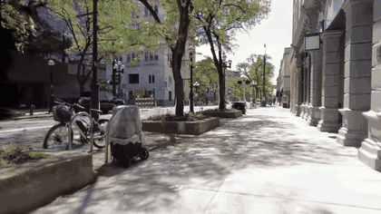
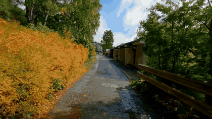
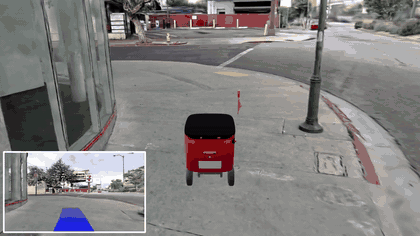
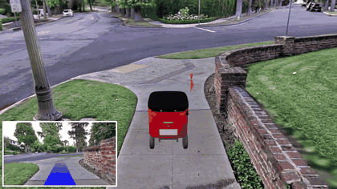

# CS163-Projects-2026Fall

The mini project is due **December 11th**.

There are two tracks: [3D Gaussian Splatting](gs-mini-project/) and [Sidewalk Navigation Model](nav-project/). Each is a complete mini project with its own instructions, code and data. You are encouraged to come up with your own ideas, and coding agents are allowed (work individually).

## Track 1: 3D Gaussian Splatting

[Instructions](gs-mini-project/README.md)

 

Given photos of a place and where each was taken, 3D Gaussian splatting (3DGS) builds a 3D model of the place from which you can render realistic images from new viewpoints. You will train 3DGS models in four parts, each on a different kind of scene, and test your own ideas for improving them.

## Track 2: Sidewalk Navigation Model

[Instructions](nav-project/README.md)

 

You will create a navigation model for a sidewalk delivery robot and test it closed loop in a 3D Gaussian splatting simulator. You get about ten hours of data from the real robot.
