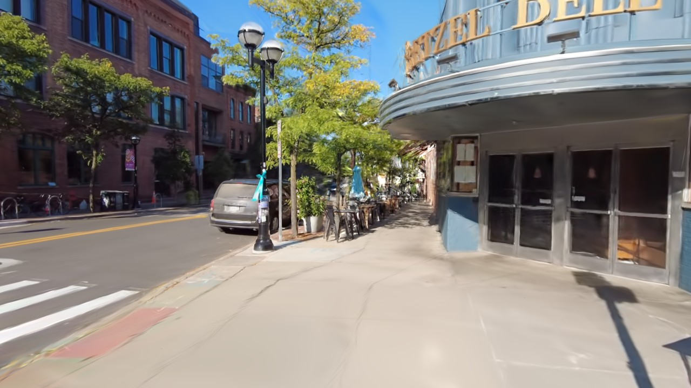
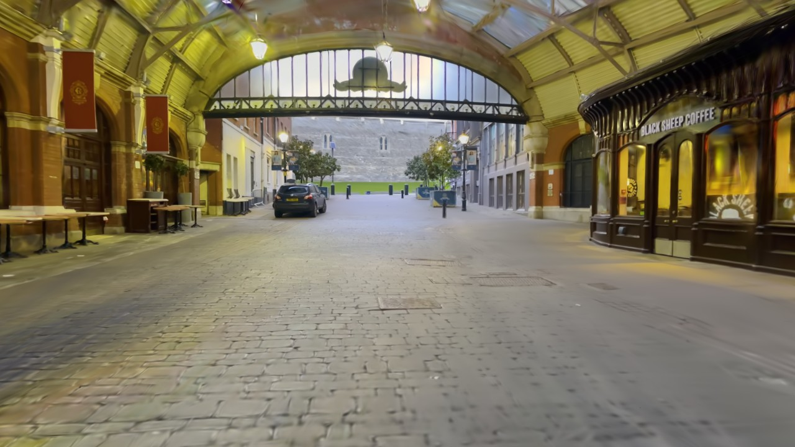
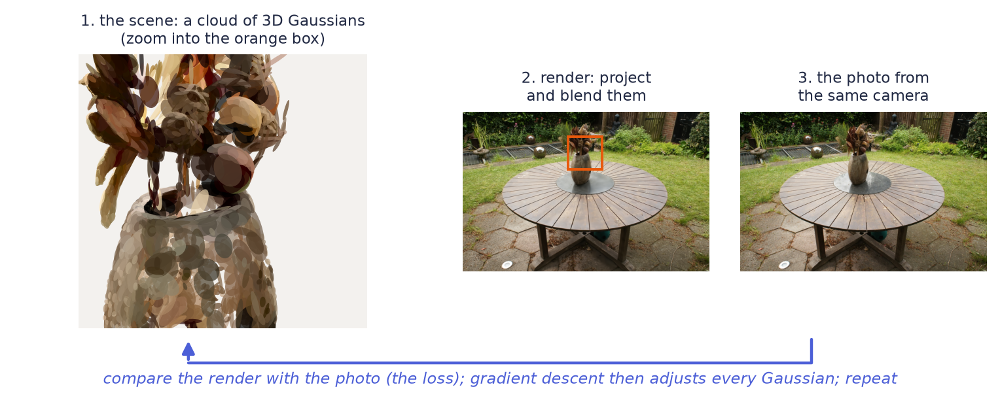
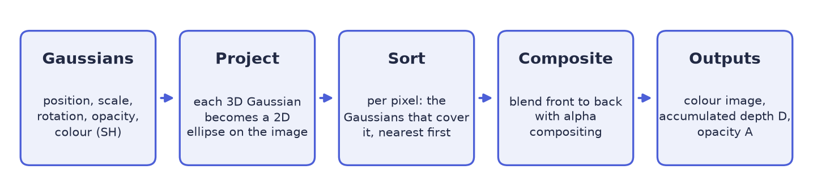
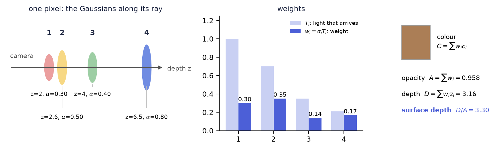
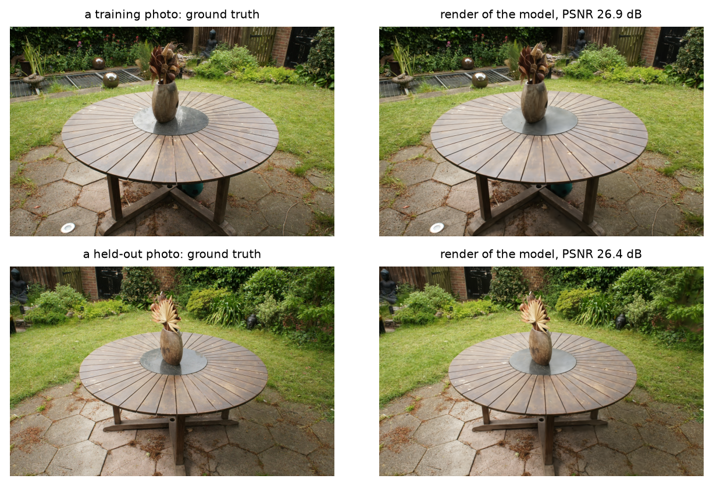
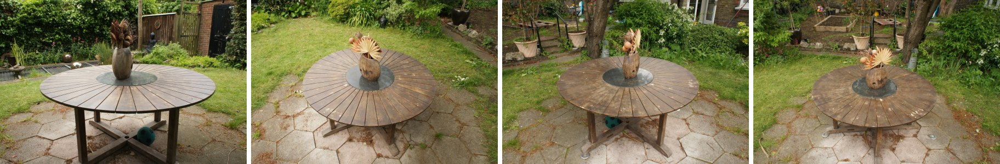
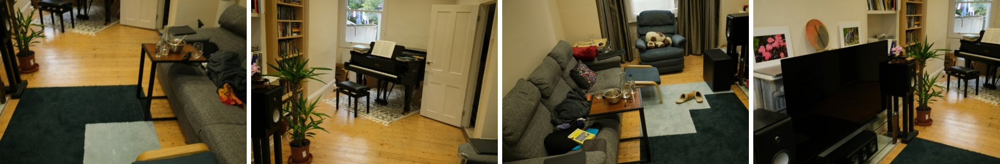
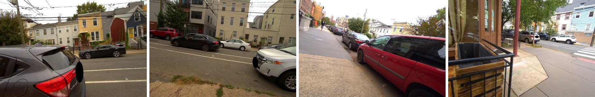
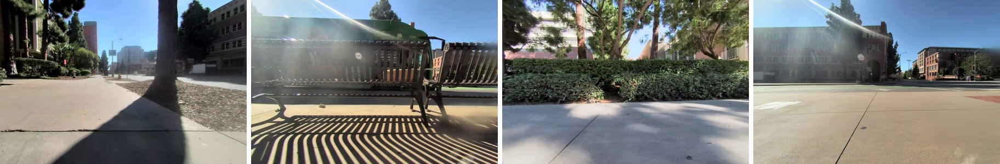

# Mini Project: 3D Gaussian Splatting

In this project you will explore 3D Gaussian Splatting (3DGS), which allows you to convert images into 3D scenes you can view from any angle, and test your own ideas for improving on baseline implementations. You are encouraged to be creative, especially in Part 4, and you may use coding agents (see the rules in Section 4).

<p align="center"> </p>
<p align="center"><sub>Renders from two 3D Gaussian splatting scenes of real places.</sub></p>

## 1. Background: how 3D Gaussian splatting works

Suppose you have photos of a place and you know where each photo was taken from. The goal is a 3D model of the place from which you can render realistic images from <em>new</em> viewpoints, where nobody took a photo (<em>novel view synthesis</em>). Such a model is a digital copy of a real place: you can fly a virtual camera through it, or test how a robot or a car would see and move in it, without going back to the site. Earlier methods such as NeRF store the scene in a neural network that must be evaluated many times for every pixel, which makes rendering slow. 3D Gaussian splatting (3DGS; Kerbl et al., 2023) is fast: a GPU can draw it in real time, and it trains in minutes. A model is judged on photos it has never seen: reproducing the training photos is easy, and getting the unseen views right is the hard part.

3DGS stores a scene as a large cloud of 3D blobs. To make an image, the blobs are projected onto the camera and blended; to learn a scene, the blobs are adjusted by gradient descent until the rendered images match the training photos. After training, the model can render the scene from new viewpoints. Every step of this process is differentiable, which is what lets you attach extra losses (on depth, for example) in this project. This section explains the pieces you need.

<p align="center"></p>

### 1.1 A scene is a cloud of Gaussians

Each Gaussian <i>i</i> has a few parameters:

| what | symbol | numbers | in our code (`gsmini/gs.py`) |
|---|---|---|---|
| position | <i>μ</i><sub>i</sub> | 3 | `means` |
| size and orientation | scale <i>s</i><sub>i</sub>, rotation <i>q</i><sub>i</sub> | 3 + 4 | `scales` (stored as a logarithm), `quats` (a unit quaternion) |
| opacity | <i>o</i><sub>i</sub> in (0, 1) | 1 | `opacities` (stored as a logit) |
| colour | spherical-harmonic (SH) coefficients | 3 × (<i>L</i>+1)<sup>2</sup> | `sh0` (the constant part), `shN` |

The scale and rotation define a 3D covariance <i>Σ</i> = <i>R S S</i><sup>T</sup> <i>R</i><sup>T</sup>, where <i>S</i> = diag(<i>s</i>) and <i>R</i> is the rotation matrix of <i>q</i>. The Gaussian is a soft ellipsoid centred at <i>μ</i>. Many tiny, flat Gaussians lying on a surface look like a surface.

The colour of a Gaussian can depend on the direction it is seen from, which lets it capture shine and view-dependent effects. This is modelled with spherical harmonics of degree <i>L</i>. Degree 0 is one fixed colour (3 numbers); degree 3 uses 16 coefficients per colour channel (48 numbers). In our trainer the degree starts at 0 and rises by one every 1,000 steps up to `--sh-degree` (default 3), so coarse colour is learned before view dependence.

### 1.2 Rendering: from Gaussians to an image

<p align="center"></p>

<b>Project.</b> A camera has intrinsics <i>K</i> and a pose. A Gaussian's centre goes to the pixel (<i>u</i>, <i>v</i>) = (<i>f</i><sub>x</sub> <i>x</i>/<i>z</i> + <i>c</i><sub>x</sub>, <i>f</i><sub>y</sub> <i>y</i>/<i>z</i> + <i>c</i><sub>y</sub>), where (<i>x</i>, <i>y</i>, <i>z</i>) is its position in camera coordinates and <i>z</i> is its depth. The 3D ellipsoid becomes, to a good approximation, a 2D ellipse with covariance <i>Σ'</i> = <i>J W Σ W</i><sup>T</sup> <i>J</i><sup>T</sup>, with <i>W</i> the world-to-camera rotation and <i>J</i> the Jacobian of the perspective projection (the "EWA splatting" approximation). You never compute this yourself; the rasteriser does it.

<b>Per-pixel opacity.</b> At a pixel <i>p</i>, Gaussian <i>i</i> has opacity

<p align="center"><i>α</i><sub>i</sub>(<i>p</i>) = <i>o</i><sub>i</sub> · exp( −½ (<i>p</i> − <i>μ'</i><sub>i</sub>)<sup>T</sup> <i>Σ'</i><sub>i</sub><sup>−1</sup> (<i>p</i> − <i>μ'</i><sub>i</sub>) )</p>

which is <i>o</i><sub>i</sub> at the centre of the ellipse and falls off smoothly towards its edge.

<b>Sort and composite.</b> For one pixel, take the Gaussians that cover it and sort them by depth <i>z</i><sub>i</sub>, nearest first. The fraction of light that gets past the Gaussians in front of number <i>i</i> is the <em>transmittance</em> <i>T</i><sub>i</sub> = ∏<sub>j\<i</sub> (1 − <i>α</i><sub>j</sub>). The pixel colour is the weighted sum

<p align="center"><i>C</i>(<i>p</i>) = ∑<sub>i</sub> <i>c</i><sub>i</sub> <i>w</i><sub>i</sub>, &nbsp;&nbsp; <i>w</i><sub>i</sub> = <i>α</i><sub>i</sub> <i>T</i><sub>i</sub></p>

The weights <i>w</i><sub>i</sub> add up to the <em>accumulated opacity</em> <i>A</i> = ∑<sub>i</sub> <i>w</i><sub>i</sub> = 1 − ∏<sub>i</sub> (1 − <i>α</i><sub>i</sub>), the fraction of the pixel that is covered by anything. Where <i>A</i> \< 1 the rest shows the background, which is black in our trainer.

<b>Depth.</b> The same weights give a depth image. The renderer sums the depths of the Gaussians with the same weights:

<p align="center"><i>D</i>(<i>p</i>) = ∑<sub>i</sub> <i>w</i><sub>i</sub> <i>z</i><sub>i</sub> &nbsp;&nbsp; (accumulated depth), &nbsp;&nbsp;&nbsp; <i>Z</i>(<i>p</i>) = <i>D</i> / <i>A</i> = ∑<sub>i</sub> <i>w</i><sub>i</sub> <i>z</i><sub>i</sub> / ∑<sub>i</sub> <i>w</i><sub>i</sub> &nbsp;&nbsp; (expected depth)</p>

<p align="center"></p>

<sub>Figure 1.1: a worked example for one pixel with four Gaussians (the numbers are exact). The light that reaches Gaussian 2 is <i>T</i><sub>2</sub> = 1 − 0.30 = 0.70, so its weight is 0.50 × 0.70 = 0.35. The weights add up to <i>A</i> = 0.958 (the pixel is almost fully covered). The accumulated depth <i>D</i> = 3.16 is <em>not</em> a depth, because the weights do not add up to 1; dividing by <i>A</i> gives the depth of the visible surface, 3.30.</sub>

> <b>Why this matters for the project.</b> The depth that `render()` returns is the accumulated depth <i>D</i> (gsplat's render mode `"D"`), and the opacity <i>A</i> comes with it. To get a depth in metres you must divide by the opacity, <i>Z</i> = <i>D</i> / <i>A</i> (gsplat's mode `"ED"`, "expected depth"; see the [gsplat documentation](https://docs.gsplat.studio/main/apis/rasterization.html)).

Rendering is fast because it is done by a tile-based CUDA rasteriser. We use the [gsplat](https://github.com/nerfstudio-project/gsplat) library for it. The parts that make training possible are the <em>gradients</em>: every output (<i>C</i>, <i>D</i>, <i>A</i>) is a smooth function of every Gaussian's position, scale, rotation, opacity and colour.

### 1.3 Training

The training loop is in `gsmini/gs.py` (`Trainer.train`, about 50 lines). It works as follows.

1. <b>Initialise</b> the Gaussians from a set of 3D points: one Gaussian per point, at the point's position, with the point's colour, opacity 0.1, a random rotation, and an isotropic size equal to the mean distance to its three nearest neighbours (so that neighbouring Gaussians overlap).
2. <b>Each step</b>, take one training photo (in random order), render it from that photo's camera pose, compare, and update all parameters with Adam.
3. <b>The loss</b> compares the render <i>Ĉ</i> and the photo <i>C</i>: &nbsp;<i>L</i> = (1 − <i>λ</i>) · L1(<i>Ĉ</i>, <i>C</i>) + <i>λ</i> · (1 − SSIM(<i>Ĉ</i>, <i>C</i>)), with <i>λ</i> = 0.2. L1 is the mean absolute colour difference; SSIM compares local structure (Section 1.4). Pixels that are masked out (people, redaction blobs) are set to zero in both images, so they contribute nothing.
4. <b>Densify.</b> A fixed set of Gaussians cannot represent a scene well, so gsplat's default strategy changes their number during training: every 100 steps (from step 500 until half-way through training), Gaussians whose position receives large gradients, which means the image there is poorly reconstructed, are duplicated (if small) or split (if large); Gaussians that have become nearly transparent are removed; and every 3,000 steps all opacities are reset to a low value, so that Gaussians that are not kept useful fade away.
5. <b>Extra losses.</b> Because depth <i>D</i> and opacity <i>A</i> are differentiable outputs too, you can add terms to the loss that use them. Parts 2 and 4 do exactly this (`extra_loss` in `Trainer`).

> <b>Initialisation matters.</b> Training does not always recover from a poor starting point, and densification only adds Gaussians where the photos say so. A good start puts the first Gaussians on real surfaces with roughly the right colours, so training begins from correct geometry instead of having to discover it from the photos alone.

### 1.4 Evaluation

We compare a rendered image <i>Ĉ</i> with the real photo <i>C</i> from the same camera, with three standard metrics:

- <b>PSNR</b> (peak signal-to-noise ratio, in dB; higher is better): 10 log<sub>10</sub>(1 / MSE) for colours in \[0, 1\], where MSE is the mean squared colour difference. Each +1 dB is about 20% less squared error. It is simple, but it punishes small misalignments of sharp detail, and a blurry image can score well.
- <b>SSIM</b> (structural similarity; higher is better, at most 1): compares the brightness, contrast and local structure of small windows of the two images.
- <b>LPIPS</b> (learned perceptual image patch similarity; lower is better): the distance between the features of the two images in a pretrained neural network (AlexNet). It tracks how different the images look to a person better than PSNR does, especially for blur.

<b>Masks.</b> In Parts 3 and 4 some pixels are masked (people who walk through the scene, and in Part 3 also license plates and the like). The masked regions are painted over with black patches in the images, for privacy. A masked pixel is not part of the scene, so all three metrics are computed over the unmasked pixels only: the MSE is averaged over them, and the SSIM and LPIPS maps (one value per pixel) are averaged over them.

<b>Held-out views.</b> What counts is how the model renders views it was <em>not</em> trained on, and how hard that is depends on how far those views are from the training photos. In a dense capture such as the Part 1 garden, a held-out view lies between training photos and is almost as good as a training view. Take photos away, or ask for views from somewhere else, and the model has to guess.

<p align="center"></p>

<sub>Figure 1.2: the Part 1 garden model after 7,000 steps (2.07 million Gaussians): a training photo and a held-out photo, each next to the model's render (scene: <em>garden</em> from the Mip-NeRF 360 dataset, Barron et al., 2022). A dense capture makes the held-out view almost as easy as the training view.</sub>

### 1.5 Viewing a `.ply` file

A trained 3DGS model can be saved as a `.ply` file, the standard format for Gaussian splats: one record per Gaussian with its position, size, rotation, opacity and colour. The Part 1 script writes one, `splat.ply`, next to its other outputs. For a run of any other part (or of your own scan), convert it with `export_ply.py`, which reads the run's `gaussians.pt`:

```
python export_ply.py --run runs/p3_best
```

To look at a `.ply` file, open [SuperSplat](https://superspl.at/editor) (`superspl.at/editor`) in a web browser and drag the file into the window. You can then fly around the model with the mouse and look at it from any viewpoint.

References: B. Kerbl, G. Kopanas, T. Leimkühler, G. Drettakis, <i>3D Gaussian Splatting for Real-Time Radiance Field Rendering</i>, ACM Transactions on Graphics, 2023 ([arXiv:2308.04079](https://arxiv.org/abs/2308.04079)). &nbsp; V. Ye et al., <i>gsplat: An Open-Source Library for Gaussian Splatting</i> ([arXiv:2409.06765](https://arxiv.org/abs/2409.06765)). &nbsp; R. Zhang et al., <i>The Unreasonable Effectiveness of Deep Features as a Perceptual Metric</i> (LPIPS), CVPR 2018 ([arXiv:1801.03924](https://arxiv.org/abs/1801.03924)).

## 2. Setup

### 2.1 Download the data

Download the four data files (`part1.tar.gz` to `part4.tar.gz`) from the [mini project data folder](https://drive.google.com/drive/folders/1km3DzPpZ_y62Htx7K5b6w7YrKi-w4rvE?usp=drive_link) on Google Drive.

### 2.2 Google Colab

The easiest way to do this project is to use Google Colab, but that's not required.

1. Upload the folder `gs-mini-project` to your Google Drive.
2. Upload the data files (`part1.tar.gz` to `part4.tar.gz`) to the folder `gs-mini-project` in your Google Drive, so that it looks like this (change `DRIVE` in the first code cell if you use another folder name):

   | file | what it is | size |
   |---|---|---|
   | `gs.ipynb` | the notebook |   |
   | `code/` (a folder) | the code | 0.1 MB |
   | `gsplat-1.5.3-cp312-cp312-linux_x86_64.whl` | gsplat, precompiled for Colab runtime 2026.07 | 20 MB |
   | `part1.tar.gz`, `part2.tar.gz`, `part3.tar.gz`, `part4.tar.gz` | the data of each part | 194, 81, 205, 95 MB |
3. Open `gs.ipynb` from there in Colab.
4. Runtime → Change runtime type → <b>T4 GPU</b> (an A100 could also work) and, under <b>Runtime version, choose 2026.07</b>. This matches the precompiled gsplat, so you do not wait for a long compile.
5. Run the cells of `gs.ipynb` from top to bottom.

### 2.3 Your own machine or a VM

You need Linux (x86-64) with an NVIDIA GPU, Python 3.12 (the version we tested; 3.10 and 3.11 should work), and PyTorch with CUDA 12.x (tested with PyTorch 2.8 and 2.11, both `cu128`). Put the data files (`part1.tar.gz` to `part4.tar.gz`) in the folder `gs-mini-project`, next to `code/`.

```
cd code
mkdir -p data && for p in 1 2 3 4; do tar xzf ../part$p.tar.gz -C data; done
python3 -m venv .venv && source .venv/bin/activate
pip install torch==2.8.0 torchvision==0.23.0 --index-url https://download.pytorch.org/whl/cu128
pip install -r requirements.txt
python check_setup.py
```

`check_setup.py` verifies Python, PyTorch and CUDA, that gsplat can be built (see below), a differentiable gsplat render (this triggers the one-time compile), the LPIPS weights, the other packages, and that the data folders are present. The data folder can be anywhere: set the environment variable `GS_DATA_DIR`. The notebook can also be used on your machine: put the files of the table above (the wheel is not needed) in the folder of the notebook, or set `GS_DRIVE` to the folder that has them, and start Jupyter in this environment.

### 2.4 Building gsplat (once, on your own machine or VM)

<b>On Google Colab you do not need to build anything:</b> the course folder contains a prebuilt gsplat wheel for Colab (runtime version 2026.07), and the notebook installs it.

On your own machine or a VM, first check whether a prebuilt gsplat wheel exists for your Python, PyTorch and CUDA versions. gsplat publishes wheels at `docs.gsplat.studio/whl`, but only for PyTorch 2.0 to 2.4 and Python 3.10. For PyTorch 2.8, the version of Section 2.3, there is none, so <b>you need to build gsplat yourself</b>. gsplat compiles its CUDA code the first time it is imported (`check_setup.py` does it for you). You do this once per PyTorch version and GPU type; the result is cached in `~/.cache/torch_extensions` (set `TORCH_EXTENSIONS_DIR` to keep it elsewhere). To build it you need:

- the <b>CUDA toolkit</b> (`nvcc` and the development headers) whose major version equals PyTorch's CUDA version. Check with `python -c "import torch; print(torch.version.cuda)"` (for example 12.8), and install that toolkit from [NVIDIA](https://developer.nvidia.com/cuda-toolkit-archive). If it is not in `/usr/local/cuda`, point `CUDA_HOME` to it;
- a C++ compiler (`g++`; on Ubuntu `sudo apt install build-essential`) and `ninja` (`pip install ninja`, already in `requirements.txt`).

`check_setup.py` tests these first and tells you which one is missing.

<em>If you would rather not compile on every machine,</em> build a wheel once and install it wherever you use the same PyTorch, Python and GPU type:

```
pip download gsplat==1.5.3 --no-deps --no-binary :all: && tar xzf gsplat-1.5.3.tar.gz && cd gsplat-1.5.3
pip install setuptools wheel
TORCH_CUDA_ARCH_LIST="8.9" python setup.py bdist_wheel      # 8.9 = RTX 40xx; 7.5 = T4 / RTX 20xx; 8.0 = A100; 8.6 = RTX 30xx; 9.0 = H100
pip install dist/gsplat-*.whl
```

`python -c "import torch; print(torch.cuda.get_device_capability())"` gives your GPU's number.

## 3. Package contents

The code is the folder `code/`. The data comes in one archive per part (Section 11 describes the formats).

```
code/
  check_setup.py        verifies your installation
  export_ply.py         turns a run into a .ply file you can open in a viewer (Section 1.5)
  requirements.txt      the packages (requirements-colab.txt: the same list for Colab)
  gsmini/               the library
    gs.py                 the Gaussians, the renderer and the trainer
    data.py               loads a scene: images, cameras, masks, splits
    metrics.py            PSNR, SSIM and LPIPS (computed over the unmasked pixels)
    report.py             result tables and image comparisons for the notebook
    depth.py              wraps the Depth Anything V2 network (Part 2)
    camopt.py             optional learnable pose corrections (Part 3, --pose-opt)
    paths.py, friendly.py   the data folder; a clear message when a TODO is not done yet
  part1/               train.py, render_video.py
  part2/               train.py, depth_losses.py (you complete), check_losses.py, gen_depth.py
  part3/               train.py, check_goal.py
  part4/               train.py, check_goal.py
  data/                 (from the data archives, Section 2.3)
    part1_garden/  part2_room/  part3_wanderland/  part4_robot/
```

Read `gsmini/gs.py` once: it is about 300 lines and contains the whole 3DGS training loop of Section 1. Parts 2 and 4 plug additional losses into it through the `extra_loss` callback of `Trainer`, and Part 3 changes its settings.

## 4. Rules

- <b>Never train on any `val*` split.</b> Their images and poses are provided only to render and evaluate them.
- You may use coding agents or assistants, but work individually and be able to explain every line you submit.
- Do not edit `gsmini/` (use the callbacks). If you think you found a bug, tell us.

## 5. Part 1: environment and baseline

<p align="center"></p>

Get started: install everything and train your first 3D Gaussian splatting model.

### Data

`data/part1_garden/` is the <em>garden</em> scene of the Mip-NeRF 360 dataset: 185 photos of a table in a garden at about 1297×840 pixels, taken around the table. 161 are training views and 24 (every eighth photo) are held out for evaluation (`val`). The training starts from 126,882 sparse 3D points of a structure-from-motion reconstruction.

### Tasks

1. Follow Section 2 until `check_setup.py` prints "Everything is set up!".
2. Read `gsmini/gs.py` (the `Gaussians`, `render` and `Trainer` classes). You should be able to point to where the Gaussians' parameters are created from the initial points, where the image is rendered, where the loss is computed, and where gsplat's `DefaultStrategy` adds and removes Gaussians (Section 1.3).
3. Train the baseline on the garden scene (7,000 steps). It writes `metrics.json`, `renders/val/*.jpg` (ground truth | render), `gaussians.pt` and `splat.ply` (drag the `.ply` into [superspl.at/editor](https://superspl.at/editor) to fly around the model):

   ```
   python part1/train.py --out runs/p1_base
   ```
4. Render a fly-through video of your model:

   ```
   python part1/render_video.py --run runs/p1_base --frames 120
   ```

### Reference result

You should get a PSNR of around 26.0.

## 6. Part 2: few views and a monocular depth prior

<p align="center"></p>

12 training photos of an indoor room is very sparse for training 3DGS. You will use the <em>Depth Anything V2</em> depth network as a geometric prior and measure how much it helps on held-out views.

### Background

A monocular depth network predicts a dense, sharp depth map for a single image, but only <b>up to an unknown scale and shift per image</b>. Depth Anything V2 outputs <em>relative inverse depth</em> ("disparity": bigger means closer). 3DGS needs geometry that is consistent across views, so the glue is: <b>align</b> each predicted map to the sparse depth you already have (the structure-from-motion points visible in that view), and then supervise the rendered depth with the aligned map. (A different route, used by FSGS and DNGaussian, replaces the alignment by a correlation loss; we do not use it here.)

### Data

`data/part2_room/` is the <em>room</em> scene of Mip-NeRF 360: 12 training views (`train`) and 39 held-out views (`val`). `points.npz` holds the <b>359</b> 3D points triangulated from the 12 training views. The depth maps of the 12 training views are included (`depth_da2_large/`); `python part2/gen_depth.py --size small|base|large` recomputes them.

### Tasks

1. Implement `l1_inverse_depth_loss(render_depth, alpha, target_inv_depth, mask=None)` in `part2/depth_losses.py` and make the check pass:

   ```
   python part2/check_losses.py
   ```

   It is the L1 difference between the rendered inverse depth and the aligned map, averaged over the pixels where `mask` is true. `render_depth` is the accumulated depth of Section 1.2, so you divide it by `alpha` to get the depth of the visible surface, and invert that to get the inverse depth. There are several divisions in this function; clamping (`tensor.clamp(min=...)`) avoids dividing by 0. The same file has two functions that are provided; read them, because they produce the aligned map that your loss compares against:

   - `fit_scale_shift(pred, target, iters=3)`: a robust least-squares fit <i>target</i> ≈ <i>a</i> · <i>pred</i> + <i>b</i>: after each fit it drops the worst 20% of the residuals and fits again.
   - `align_depth_to_sparse(disp, xy, z)`: fits the network's \[H, W\] output `disp` to the inverse depth 1/<i>z</i> of the sparse points visible in this view (pixel coordinates `xy` \[M, 2\], depths `z` \[M\]) and returns the aligned \[H, W\] map, <i>a</i> · `disp` + <i>b</i>, an inverse depth in the units of the reconstruction. The fit is done in inverse depth, where the network's error is closest to an affine transform. It returns `None` if fewer than 8 usable points remain.
2. Train the baseline and the depth-prior run. `part2/train.py` aligns the network's maps once at the start (it reports `aligned depth for 8/12 views`; the other four views have too few sparse points and get no depth loss) and then adds your loss to the photometric loss with the weight `--w` (default 1.0), which decays to 10% over the training:

   ```
   python part2/train.py --loss none --out runs/p2_base
   python part2/train.py --loss l1 --out runs/p2_l1
   ```

### Target

Your depth-prior run needs to improve on the baseline by at least 1.0 dB PSNR on the held-out views.

## 7. Part 3: a better training recipe for a street scene

<p align="center"></p>

Reconstruct a street from a handheld two-camera capture. The baseline of Part 1 works well on a dense capture like the garden, but here it renders views from another trajectory poorly. You do not add any data or any loss in this part. You change <em>how the model is trained</em>.

### Data

`data/part3_wanderland/` is a street in Jersey City captured with a handheld rig (a left and a right camera, 90-degree pinhole views of 800×800 pixels) from the Wanderland dataset, with poses from the dataset's LiDAR SLAM.

- `train` (693 frames) and `val_offtraj` (73 frames). `part3/train.py` evaluates `val_offtraj`.
- `masks/`: people, license plates, etc. are masked (0 = ignore) in every frame, also in the validation frames. About 0.6% of the pixels are masked on average, about 15% of a frame at most. The photometric loss ignores masked pixels, and <b>all metrics (PSNR, SSIM, LPIPS) are computed over the unmasked pixels only</b>.
- `points.npz`: 62,310 structure-from-motion points (the initial Gaussians).

### Settings

<b>Densification.</b> Section 1.3 describes how gsplat adds and removes Gaussians during training. Two settings of it are flags of `part3/train.py` (the defaults of the flags are the baseline):

- `--refine-every`: how often (in steps) gsplat looks for Gaussians to split, duplicate or remove.
- `--reset-every`: every this many steps all opacities are set back to a low value, so that Gaussians that are not needed fade away. A very large number means never.

<b>Training length.</b> `--steps` sets how many steps the model trains for (the default is 7000). The length is part of what you can explore.

These settings interact with each other and with the camera poses below: one that makes the result worse on its own can help in combination with another, so do not judge a change only by itself.

<b>Camera poses.</b> The poses of this scene come from a LiDAR SLAM system and are not perfect: a pose that is off by a fraction of a degree moves the image by several pixels, which blurs fine detail. With `--pose-opt` the model learns a small correction for every training frame and one shared correction for each of the two cameras, together with the Gaussians (`--pose-lr` sets how fast).

### Tasks

You need to run at least three different experiments (besides the baseline), each with different settings, and report the image metrics for each one.

1. <b>Baseline.</b> Train it with the default settings and look at the numbers and at the renders in `runs/p3_base/renders/val_offtraj/` (ground truth | render):

   ```
   python part3/train.py --out runs/p3_base
   ```
2. <b>Try different settings.</b> Change the settings above, alone or together, train, and compare each run with the baseline on `val_offtraj`. Each flag takes a value, and every run needs its own `--out` name:

   ```
   python part3/train.py --refine-every 500 --out runs/p3_try1
   ```
3. <b>Your best run.</b> Write it to `runs/p3_best`, with whatever flags you found:

   ```
   python part3/train.py <your flags> --out runs/p3_best
   ```

### Target

Get a run that is at least +0.75 PSNR above the baseline on `val_offtraj`. The baseline has to be trained with the default number of steps (7000); your best run can use any number of steps. The check below refuses a baseline that used another number:

```
python part3/check_goal.py --baseline runs/p3_base --mine runs/p3_best
```

## 8. Part 4: a real robot

<p align="center"></p>

A delivery robot drove the same sidewalk route twice. From the first drive (a front camera plus a LiDAR) you reconstruct the scene with 3D Gaussian splatting, and the model is judged on <b>images from the second drive</b>: new viewpoints, a different time, up to about a metre and a half away from anything the model saw. The baseline is plain 3DGS, started from randomly placed Gaussians because no initial point cloud is provided. You must reach an <b>LPIPS of at most 0.58</b> on the second drive; the baseline gets about 0.62. LPIPS measures how different a render looks from the real photo, so <b>lower is better</b>.

### Data

`data/part4_robot/`: one world frame in metres (z up); images are 960×540 and undistorted. `cameras.json` gives each frame’s intrinsics `K` and camera-to-world pose `c2w`, in this same world frame as the scan poses below. The splits (lists in `cameras.json`):

- `train_front` (249 views): drive 1, front camera.
- `val_pass2` (132 views): the front camera on drive 2.
- `masks/`: 0 = a person, 255 = everything else; ignore the 0-pixels. The people are painted black in the images. All metrics are computed over the unmasked pixels only. Vehicles (a passing bus and cars), sun glare and haze are not masked.
- `lidar/scans.npz`: the raw LiDAR scans of drive 1, 145 of them, nothing removed or merged. `points` \[N, 3\] are all the returns in the LiDAR’s own frame (metres), and `scan_id` \[N\] says which scan each point belongs to. `world_T_lidar` \[145, 4, 4\] is the pose of the sensor for each scan: a point <i>p</i> of scan <i>k</i> is at <i>R p + t</i> in the world, with <i>R</i>, <i>t</i> from the top rows of `world_T_lidar[k]`. `scan_time` \[145\] is the time of each scan in seconds, on the same clock as the `time` of each frame in `cameras.json`; a scan differs from the nearest image by up to 0.2 s. The scans contain everything the LiDAR hit, including people and vehicles.

### Tasks

1. <b>Baseline</b>. Train it and look at the numbers and the renders. It starts from 300,000 random points in a cube around the training cameras (random colours); `--cube` sets the cube's size:

   ```
   python part4/train.py --out runs/p4_base
   ```
2. <b>Improve it.</b> Use the training photos and the LiDAR scans of drive 1 however you like. You may change anything in `part4/` (edit `train.py` or add your own files). Some ideas you could try are a sky map, a better initialisation, depth supervision, correction for image signal processing, or generative methods such as Difix3D+. You may use only the training frames and the LiDAR of drive 1, not the second drive. `part4/train.py` can start from initial Gaussians of your own: `--init file --init-file my_init.npz` loads an `.npz` file with `xyz` \[N, 3\] (world frame, metres) and `rgb` \[N, 3\] (uint8). Write your final run to `runs/p4_mine`:

   ```
   python part4/train.py --out runs/p4_mine
   ```

### Target

Your `val_pass2` LPIPS needs to be at most 0.58 (lower is better):

```
python part4/check_goal.py --mine runs/p4_mine
```

## 9. Grading and submission

| part | points | requirements |
|---|---|---|
| Part&nbsp;1 | 10 | You ran the baseline: `check_setup.py` passes and the baseline trains. |
| Part&nbsp;2 | 25 | `check_losses.py` passes, and the depth prior improves on the baseline by at least 1.0 dB PSNR (Section 6). |
| Part&nbsp;3 | 30 | Your best run is at least +0.75 dB PSNR above the baseline on `val_offtraj` (`check_goal.py`, Section 7). |
| Part&nbsp;4 | 35 | Your model reaches an LPIPS of at most 0.58 on the second drive (`check_goal.py`; lower is better), and you explain the approach you came up with. |

Your report has to include all the experiments you ran in each part and the result of each. For Part 4 it also has to explain the approach you came up with: what you did and why.

### Extra credit (+10 points)

You can scan a real-world environment, build a 3DGS model of it, and drive a robot in it using the code from the navigation model mini project. Include a video of the robot driving in that environment in your submission, and a text file with Google Drive links to your 3DGS reconstruction (`.ply` file) and to your raw scan data.

### Submission

Submit one zip file named `gs.zip` on Bruin Learn by <b>December 11th</b> containing:

- your entire code directory (`code/`, with your changes), <b>but without the data and without the model checkpoints (</b>`gaussians.pt`<b>)</b>
- renders from your best 3DGS model in each part
- a short report (PDF). It has to include all the experiments you ran in each part and the result of each; for Part 4 it also explains the approach you came up with: what you did and why.
- (optional, for the extra credit) the video of the robot driving in your own scanned environment, and a text file with Google Drive links to your 3DGS reconstruction (`.ply` file) and to your raw scan data

## 10. Troubleshooting

| problem | remedy |
|---|---|
| `torch.cuda.is_available()` is False | install the CUDA build of PyTorch (the command in Section 2.3) and check `nvidia-smi`; on Colab, choose a GPU runtime |
| gsplat compile fails or hangs | try to use a pre-built wheel; we provide one that works with Colab |
| gsplat compile error mentioning the CUDA version | the CUDA toolkit's major version must equal PyTorch's (`torch.version.cuda`): install a matching toolkit and `export CUDA_HOME=/usr/local/cuda-12.8` (or wherever it is) |
| Colab: "This runtime has Python 3.13 ..." or a long compile | the precompiled gsplat is for runtime version 2026.07: Runtime → Change runtime type → Runtime version, then run the notebook again from the top |
| Colab: "the code folder was not found" | check that the folder `code` is in your Drive folder `gs-mini-project` (and that `DRIVE` in the first code cell names that folder) |
| CUDA out of memory | close other GPU programs |
| the depth-model download fails (Part 2, optional) | check internet access to huggingface.co; set `HF_HOME` to a folder with space (the models are about 1.3 GB each) |
| `NOT IMPLEMENTED YET: complete the TODO in ...` | you have not completed that function yet; the message names the file and the function; run the part's check script |

## 11. Appendix

### 11.1 Scene format

Every part's data lives in `data/<scene>/` with this layout, read by `gsmini/data.py` (`Scene`):

```
data/<scene>/
  images/<name>.jpg             RGB, already undistorted (pinhole), one file per frame
  cameras.json                  see below
  points.npz                    xyz [N,3] float32 (world frame), rgb [N,3] uint8: initialisation points (Parts 1 to 3)
  (optional) masks/<name>.png   uint8, 255 = valid / static pixel, 0 = ignore (people, redaction blobs ...)
  (optional) lidar/...          Part 4
```

```
cameras.json:
{
  "meta":   {"name": "...", "units": "metres" | "colmap-arbitrary", "note": "..."},
  "frames": [
    {"file": "images/000123.jpg",
     "w": 960, "h": 540,
     "K": [[fx,0,cx],[0,fy,cy],[0,0,1]],      # for the image at its stored resolution
     "c2w": [[4x4]],                           # camera-to-world, OpenCV convention (x right, y down, z forward)
     "camera": "front",                        # which physical camera
     "time": 12.3}                             # optional, seconds
  ],
  "splits": {"train": [frame indices], "val": [...], ...}   # named lists of indices into "frames"
}
```

Optional per-frame data (depth maps and so on) lives in `<scene>/<kind>/<name>.npy`. The scenes of Parts 1 and 2 are in COLMAP's arbitrary units; Parts 3 and 4 are in metres.

### 11.2 Splits

| part | scene | images | splits (number of frames) |
|---|---|---|---|
| 1 | `part1_garden` | 185 at about 1297×840 | `train` 161, `val` 24 (every 8th) |
| 2 | `part2_room` | 311 at 779×519 | `train` 12, `val` 39, `train_dense` 272 (only for upper-bound experiments) |
| 3 | `part3_wanderland` | 766 at 800×800 | `train` 693, `val_offtraj` 73 (a different trajectory) |
| 4 | `part4_robot` | 381 at 960×540 | `train_front` 249, `val_pass2` 132 |

### 11.3 Data sources, licences and citations

Mip-NeRF 360 (J. T. Barron et al., CVPR 2022; research use, see the project page): the scenes of Parts 1 and 2. Wanderland (Liu et al., CVPR 2026; Apache-2.0 on the dataset card, [github.com/ai4ce/wanderland](https://github.com/ai4ce/wanderland)): the scene of Part 3. The robot data of Part 4 is course data. Depth Anything V2 (Yang et al., 2024) provides the depth maps of Part 2. SAM 3 (Meta, 2025) was used to produce the people masks of Parts 3 and 4. 3D Gaussian splatting (Kerbl et al., 2023) and gsplat (Ye et al., 2024) are cited in Section 1.
