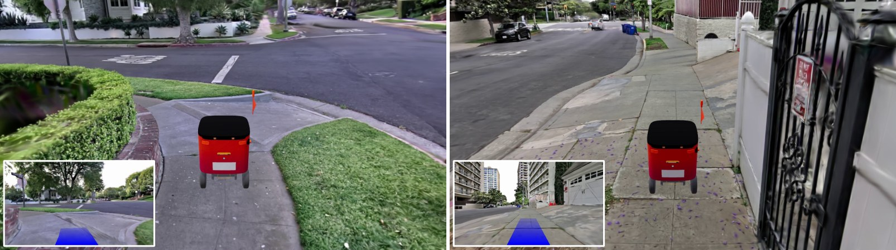
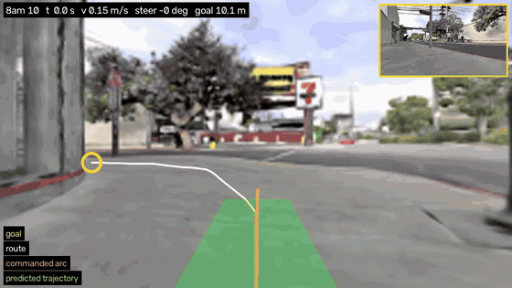

# Mini Project: Sidewalk Navigation Model

In this mini project you will create a navigation model for a sidewalk delivery robot and test it closed-loop in a 3D Gaussian splatting (3DGS) simulator. We have given you access to around ten hours of data logged from the delivery robot your model will control, and you are welcome to use additional data. Coding agents are allowed.

<p align="center"></p>

You are encouraged to come up with your own ideas for this project. To help you, we have included some starter code for fine-tuning ViNT, a foundation navigation model, on the training data, but you are free to do whatever you want.

To get full credit on this project, you need to satisfy one of the following: either improve the success rate on the development benchmark by at least 10 percentage points compared to the model that is your starting point (for example, if it succeeds 25% of the time, yours needs to reach at least 35%), or achieve an overall success rate of at least 75% on the development benchmark. Additionally, the top 20% of models on the held-out testing benchmark will receive some extra credit (you will not be penalized if your model does not perform well on the testing benchmark).

You will need to submit your model (as an ONNX file) and a brief report about the experiments you did and your findings.

## 1. Setup

### 1.1 Download the data

Download `nav-assets.tar` and `processed-data.tar` from the [mini project data folder](https://drive.google.com/drive/folders/1km3DzPpZ_y62Htx7K5b6w7YrKi-w4rvE?usp=drive_link) on Google Drive. (`data.tar`, the raw clips, is optional: see Section 3.)

### 1.2 Google Colab

The easiest way to do this project is to use Google Colab, but that's not required. Clone the repository on your computer, put the data files in the `nav-project` folder, upload the `nav-project` folder to your Google Drive, open `navigation_colab.ipynb` from there in Google Colab, and run it. It does the remaining steps below for you (install, `unpack_files.py` and `check_setup.py`).

### 1.3 Your own machine

Python 3.10 to 3.13 on Linux or macOS is suggested. The simulator can run CPU-only, but training requires a GPU. Get the code and run everything in this document from inside the `mini-project-nav` folder:

```
# the data files are in the nav-project folder
cd nav-project/mini-project-nav
python3 -m venv .venv
source .venv/bin/activate
pip install -r requirements.txt
python unpack_files.py
python check_setup.py
```

`unpack_files.py` unpacks `nav-assets.tar` (the pretrained model and the scenes) and `processed-data.tar` (the training data) where the code expects them. If a file is missing it tells you which one and where to save it.

`check_setup.py` tests the packages, collision checking, rendering, the model and a short simulated drive, and reports which step failed. On Linux without an NVIDIA GPU, install the CPU build of PyTorch: `pip install --extra-index-url https://download.pytorch.org/whl/cpu -r requirements.txt`. If `python-fcl` fails to install, use `conda install -c conda-forge python-fcl`. On a Mac, Apple Silicon with macOS 14 or newer is recommended.

Then score the original model on one scene:

```
python evaluate.py --policy code/policy.py --scenes 8am
```

## 2. Package Contents

```
nav-project/
  navigation_colab.ipynb        the Colab notebook
  nav-assets.tar                the pretrained model and the scenes (provided separately)
  processed-data.tar            the preprocessed training data (provided separately)
  data.tar                      the raw clips, optional (provided separately)
  mini-project-nav/
    requirements.txt            the Python packages to install
    unpack_files.py             unpacks the model, the scenes and the data
    check_setup.py              tests the installation
    check_submission.py         checks your model file before submission
    evaluate.py                 runs a policy on the benchmark
    viewer.py                   shows a policy driving in the browser
    sim/                        the simulator
    assets/                     the robot model that the viewer draws
    evaluation-scenes/          dev.json (53 episodes) and the scenes (from nav-assets.tar)
    code/
      vint.pt                   the pretrained ViNT weights (from nav-assets.tar)
      vint_net.py               the ViNT network (plain PyTorch)
      vint.py                   loads the model and wraps it for the simulator
      prepare_data.py           converts the clips into training frames
      dataset.py                one training sample
      train.py                  the fine-tuning script (you complete it)
      export_onnx.py            writes the ONNX file you submit
      policy.py                 the policy for your own runs
      onnx_policy.py            the policy the graders use
```

## 3. Training Data

We provide both the raw training data (`data.tar`, 5.7 GB) and the preprocessed data (`processed-data.tar`, ready for ViNT fine-tuning). `unpack_files.py` has already unpacked the preprocessed data into `data/processed`. You only need the raw data if you want to make your own training frames.

The raw training data is 1,800 clips of 20 seconds each, recorded by the robot. Faces are blurred. Each clip is a folder with:

| file | contents |
|---|---|
| `front_fe_384x216.mp4` | front camera, 20 frames per second, fisheye lens |
| `frame_positions.npy` | robot position per frame in meters, \[N, 3\] |
| `frame_orientations.npy` | orientation per frame as a quaternion (w, x, y, z), \[N, 4\] |
| `frame_times.npy`, `frame_speeds.npy`, `frame_*_velocities.npy` | timestamps (ns) and velocities |

- Use the quaternion for the heading. `frame_yaw_deg.npy` does not match the direction of travel.
- The clips come from a fisheye camera; the simulator renders a pinhole camera with a 90 degree horizontal field of view. The frames must be undistorted to match. The calibration of the 1920x1080 camera (OpenCV fisheye model; the videos are 384x216, so K is scaled by 0.2) is below, and `prepare_data.py` applies it.

```
K = [[790, 0, 960], [0, 790, 540], [0, 0, 1]]
D = [-0.03054249, 0.00974967, -0.00679687, 0.00238449]
```

- `code/dataset.py` splits 80% / 10% / 10% into training, validation and test.

To prepare the data yourself, save `data.tar` in the `nav-project` folder with the other tar files, unpack it into a folder, and run the script:

```
mkdir -p clips
tar xf ../data.tar -C clips
python code/prepare_data.py --clips clips --out data/processed
```

The script keeps every fifth frame (4 frames per second, the rate at which the simulator calls the model), undistorts it, and resizes it to the 85 x 64 pixels the model reads, applying the same alignment (`vint.align`) that is applied to simulator images. The output is about 2.3 GB.

The preprocessed data, `processed-data.tar`, contains the result of this script and can be used directly for training ViNT; it is what `unpack_files.py` unpacked into `data/processed`.

It contains `frames.npy` (uint8 \[144000, 64, 85, 3\], RGB frames at 4 per second), `poses.npy` (float64 \[144000, 3\]: robot position x, y in meters and heading in radians) and `index.json` (one entry per clip: its name, its recording, the row where it starts in the arrays, and its length).

## 4. Benchmark

The development benchmark uses four scenes reconstructed as 3D Gaussian splats: 8am, dark, round and hill. 53 episodes are provided. Each is a route of 10 to 15 meters.

<b>Model inputs.</b> The simulator calls the model four times per second. It provides:

- the last camera images, 0.25 s apart (up to 25; ViNT uses six);
- the goal point: the end of the route as (forward, left) in meters in the robot's frame (`obs.goal`);
- the goal image: the picture the camera would take at the end of the route, looking along it (`obs.goal_image`). It is the same for the whole episode.

Your model doesn't need to use all of these inputs. For example, ViNT uses the goal image and ignores the goal point.

<b>Model output.</b> Five waypoints: where the robot should be 0.25, 0.5, 0.75, 1.0 and 1.25 seconds from now, as (forward, left) in meters. The PD controller of the simulator (`code/policy.py`) converts them into a speed and a yaw rate.

<b>Robot.</b> The simulated robot is the COCO delivery robot: 0.76 m long and 0.61 m wide, and it collides with the scene as a box of that size. It is car-like: it steers with its front axle and cannot turn in place. The tightest turn has a radius of about 1.25 m. Physics runs at 40 Hz and each command is held for ten physics steps.

<b>Score.</b> The score is the percentage of episodes in which the robot reaches the goal without a collision. An episode succeeds when the center of the robot is within 1 m of the end of the route. It fails at the first contact with the scene, when the robot leaves the walkable area, when it makes less than 10 cm of progress in 5 seconds, or at the time limit (2.5 seconds per meter of route, at least 45 seconds). The results file also reports the collision rate.

Keep in mind that the simulator is mostly but not entirely deterministic.

## 5. Running the Evaluation

```
# the original model
python evaluate.py --policy code/policy.py
# fine-tuned weights
python evaluate.py --policy code/policy.py --checkpoint runs/a/last.pt
# selected scenes, or a video of every episode
python evaluate.py --policy code/policy.py --scenes dark hill
python evaluate.py --policy code/policy.py --save_video videos/original
```

The script prints one line per episode and a summary, and writes `results/policy.json`. With `--save_video`, each episode is a first-person video showing the predicted trajectory (green), the arc the robot is driving (orange), the route (white) and the goal image (top right).

<p align="center"></p>

Rendering uses an NVIDIA GPU if available and the CPU otherwise.

To watch a policy drive in the browser:

```
python viewer.py --policy code/policy.py --checkpoint runs/a/last.pt
```

To watch an exported model instead (for example `submission.onnx`):

```
python viewer.py --policy code/onnx_policy.py --onnx submission.onnx
```

Open `http://localhost:8080`, choose a scene and a route, and run an episode. Keep that tab visible: in the viewer your browser draws the robot's camera pictures, which is fast on any computer with a graphics card. They differ slightly from the pictures `evaluate.py` renders, so an episode can end differently in the viewer; the scores of `evaluate.py` are the ones that count. With `--sim_camera` the viewer uses the same renderer as `evaluate.py`.

## 6. Starter Code Guide

You are not required to follow our starter code. It is not optimal and is just intended to be a starting point. If you would like to use it, read the following:

Data loading, the validation metric and checkpointing are done, however you are welcome to change them. `train.py` is a skeleton. Complete the parts marked TODO: which parameters to train, the optimizer and learning rate schedule, the loss, the training step, etc. Run it unchanged first: it prints the validation error of the original model (0.76 m, the average distance between predicted and true waypoints) and of a baseline that always predicts the average path (0.50 m), and stops at the first TODO. Once completed, it saves `last.pt` after every epoch and `best.pt` for the lowest validation error. You might need to change the learning rate or other hyperparameters.

A training sample consists of six frames 0.25 s apart, a goal image (a later frame of the same clip), and the robot's positions over the next 1.25 s. Positions are in model units of 0.8 m. `code/dataset.py` has the details.

```
python code/train.py --data data/processed --out runs/a
python evaluate.py --policy code/policy.py --checkpoint runs/a/last.pt
```

`code/policy.py` is the policy for your own runs: the model followed by the PD controller.

## 7. Submission and Grading

To submit a model, export it to ONNX with `export_module` from `code/export_onnx.py`. It works for any PyTorch module. If you fine-tuned ViNT with `train.py`:

```
import sys; sys.path.append("code")
from vint import Waypoints, load_model
from export_onnx import export_module
export_module(Waypoints(load_model("runs/a/last.pt")), "submission.onnx")
```

The file receives the camera images as the simulator renders them; resizing, alignment, normalization and stacking happen inside the file. Its interface is:

| name | type | shape | contents |
|---|---|---|---|
| `images` | `uint8` | `[1, T, 126, 224, 3]` | last T images, oldest first, 0.25 s apart |
| `goal_image` | `uint8` | `[1, 126, 224, 3]` | camera image at the end of the route |
| `goal` | `float32` | `[1, 2]` | end of the route: (forward, left) in meters |
| `waypoints` (output) | `float32` | `[1, 5, 2]` | next 5 positions, 0.25 s apart, in meters |

T is fixed by the file and may be anywhere from 1 to 25.

Your model does not have to use this interface internally. The ONNX file is a wrapper: it can resize or crop the images, pick which frames to use, and convert the model's output (a different number of waypoints, a different time spacing, normalized units, or velocities) into five positions in meters. Only the inputs and outputs of the file have to match the table. Everything in it must be exportable to ONNX.

To export a ViNT that you changed (for example with extra layers), or a different model, pass your own PyTorch module to `export_module` instead of `Waypoints(...)`. It must take `images`, `goal_image` and `goal` as in the table above and return the waypoints, shape \[1, 5, 2\], in meters. Resizing and normalization go inside the module; `Waypoints` in `code/vint.py` is an example. `export_module` also checks that ONNX Runtime gives the same output as your module. If the export fails, the error names the operation that is not supported: replace it with a simpler one.

Check the file with `python check_submission.py submission.onnx`, and score it as the graders will with `python evaluate.py --policy code/onnx_policy.py --onnx submission.onnx`.

Submit a zip file named `nav.zip` on Bruin Learn by <b>December 11th</b> containing `submission.onnx`, your report, and all of the code that you edited or created in a folder called `code/`. The model file must pass `check_submission.py`: one file of at most 1 GB and no external weight files. To be considered for extra credit, your `submission.onnx` must work in the provided Colab notebook, without any changes to the simulator or `onnx_policy.py`.

| part | points | requirement |
|---|---|---|
| Closed-loop score | 60 | A success rate on the development benchmark at least 10 percentage points above your base model's, or at least 75%. Below that, the points are proportional to the improvement over your base model. |
| Report | 40 | See below. |

<b>Extra credit.</b> The top 20% of submissions on the held-out testing benchmark receive extra credit. A lower held-out score is not penalized.

<b>Report.</b> The report contains:

- Results (success rate, collision rate) for your final model and the other models you tried. (20 points)
- Three or more experiments, each changing one factor (for example which weights are trained, the learning rate, the number of goal steps, or the loss), with scores and an explanation of the behavior. (10 points)
- A failure analysis of the episodes your best model still fails, based on the videos (`--save_video`): what goes wrong (for example cutting a corner, drifting off the sidewalk, or stopping) and what the model appears to be missing. Include two or three screenshots from the videos. (10 points)

## 8. Important Notes

- The contents of the development benchmark should not be used to train your model.
- Don't make any changes to `policy.py`, except performance optimizations for your own testing.
- The submitted file must pass `check_submission.py`.
- You are allowed to use coding agents, but work individually.

## 9. Troubleshooting

| problem | remedy |
|---|---|
| `python-fcl` does not install | `conda install -c conda-forge python-fcl` |
| the evaluation is slow | close other programs and run one evaluation at a time |
| `viewer.py` shows nothing | open the address printed in the terminal, keep its tab visible, try another browser, and check the terminal for errors |
| out of memory during training | lower `--batch` and `--workers` |
| `--device mps` reports an unsupported operation | set `PYTORCH_ENABLE_MPS_FALLBACK=1`, or omit `--device mps` |
| results differ slightly from another student's | different hardware can change the last digits of the rendering; scores should be close |
